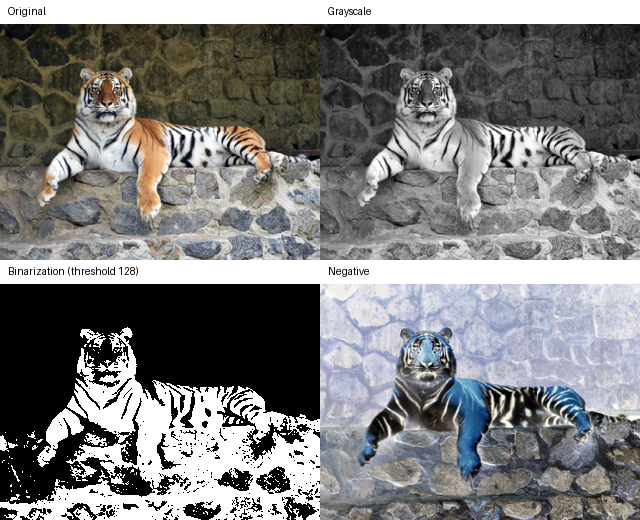

# Computer Graphics and Visualization

Four standalone Python/Tkinter labs for image processing. Each lab has a GUI and tests for its image operations; later labs include the earlier operations.



This Lab 04 example uses the [tiger input image](assets/input/tigr-1024x754.jpg), resized to 320 × 236 pixels. The three results come from `to_grayscale`, `binarize` at threshold 128, and `negative` in [Lab 04's operations](labs/lab04/operations.py). These are processed images, not GUI screenshots.

## Labs

| Lab | What it adds |
| --- | --- |
| [01 — Basic image operations](labs/lab01/main.py) | Format conversion, proportional resizing, color replacement, and RGB balance. [Tests](labs/lab01/tests/test_operations.py) and [report](reports/Звіт_ЛР1_КГВ_Агапов.docx). |
| [02 — Regions and contrast](labs/lab02/README.md) | Transparency, cropping, removing an area, splitting an image, and contrast adjustment. |
| [03 — Compositing](labs/lab03/README.md) | Horizontal or vertical merging, text watermarks, and a slideshow. |
| [04 — Brightness and tone](labs/lab04/README.md) | Brightness matrix and histograms, grayscale, threshold binarization, and negative images. The preview above shows three of these results. |

Labs 02–04 have their own README files, tests, and reports. Lab 01 has [source code](labs/lab01/), [tests](labs/lab01/tests/test_operations.py), and the linked report.

## Run and test

Use Python 3.10 or newer with Tkinter and the packages in [requirements.txt](requirements.txt). From the repository root:

```bash
python -m pip install -r requirements.txt
```

Run the chosen lab from its directory, for example:

```bash
cd labs/lab04
python main.py
python -m pytest
```

Use the same commands in `labs/lab01`, `labs/lab02`, or `labs/lab03`. The GUI needs a desktop display. Choose an image from [the sample inputs](assets/input/) and an output folder for operations that save files. Processed files are created locally; the preview above is the tracked example.
