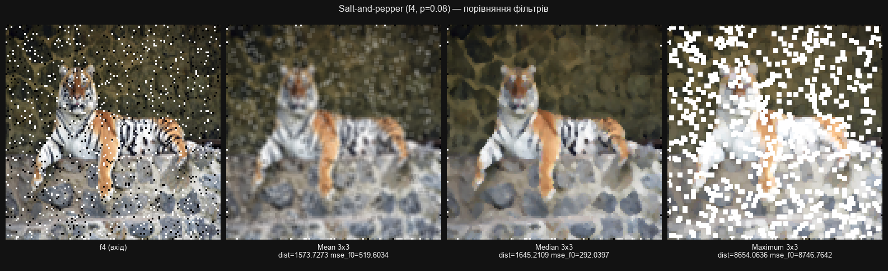
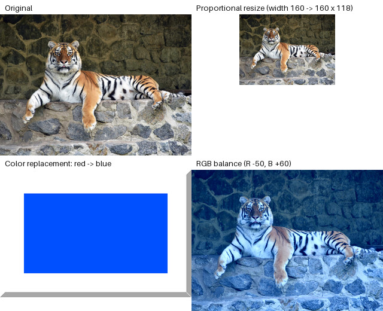
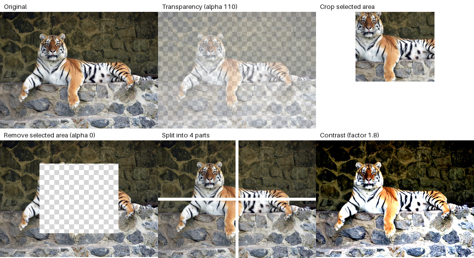
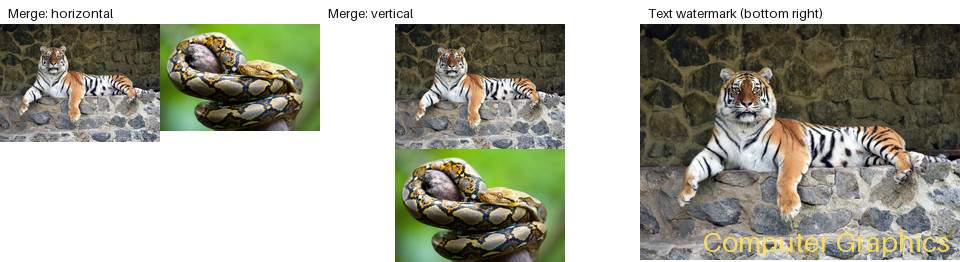
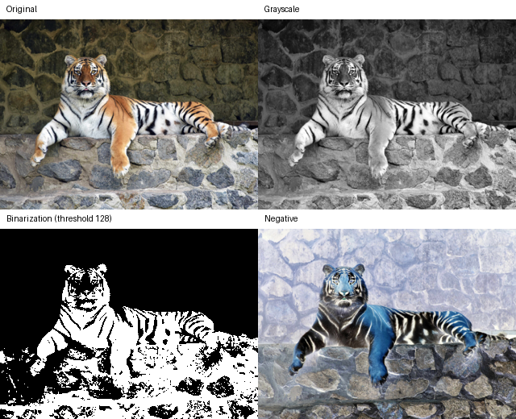
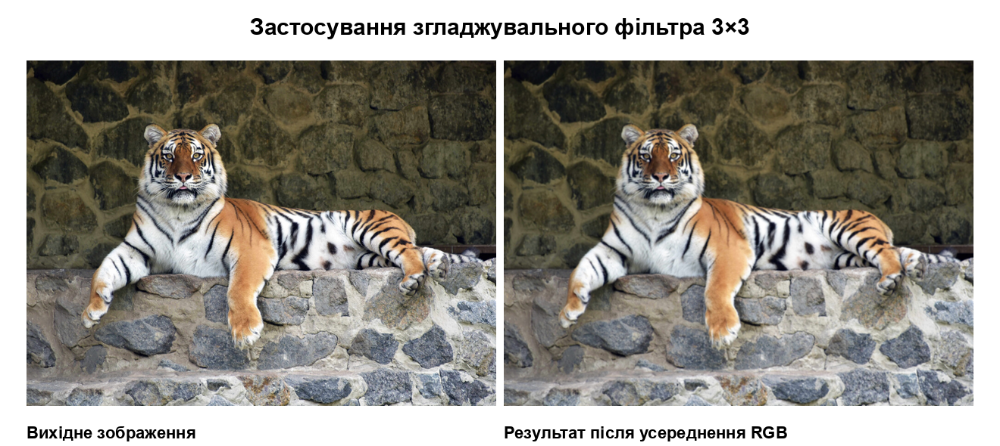
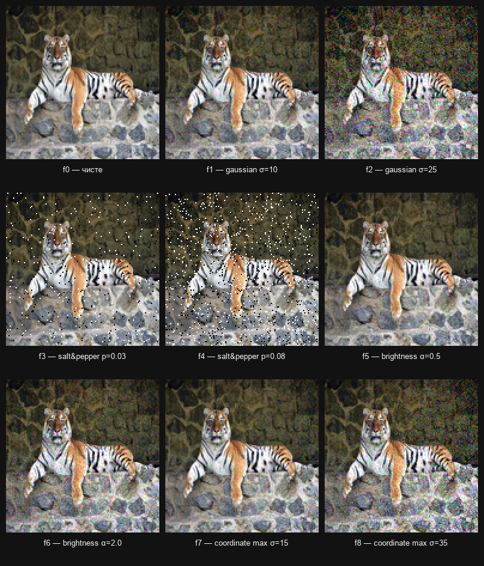

# Computer Graphics and Visualization

Six standalone Python/Tkinter labs for image processing, from format conversion and tonal transforms to hand-written noise filters judged with a numeric quality metric. Each lab has a GUI and tests; later labs include the earlier operations.



*Lab 06: three of ten hand-written filters on salt-and-pepper noise. The median filter ends up closest to the clean image. The figure comes from the lab's own filters and metric; its titles are partly Ukrainian.*

## Labs

| Lab | What it adds |
| --- | --- |
| [01 — Basic image operations](labs/lab01/README.md) | Format conversion, proportional resizing, color replacement, and RGB balance. |
| [02 — Regions and contrast](labs/lab02/README.md) | Transparency, cropping, removing an area, splitting an image, and contrast adjustment. |
| [03 — Compositing](labs/lab03/README.md) | Horizontal or vertical merging, text watermarks, and a slideshow. |
| [04 — Brightness and tone](labs/lab04/README.md) | Brightness matrix and histograms, grayscale, threshold binarization, and negative images. |
| [05 — Smoothing filter](labs/lab05/README.md) | A hand-written 3×3 mean filter. |
| [06 — Filtering quality](labs/lab06/README.md) | Four noise types, ten linear and nonlinear filters, and an MSE-based comparison saved to `metrics.csv`. |

Every lab folder has its own README and tests. Reports, written in Ukrainian, are included for [Lab 01](reports/Звіт_ЛР1_КГВ_Агапов.docx), [Lab 02](reports/Звіт_ЛР2_КГВ_Агапов.docx), [Lab 03](reports/Звіт_ЛР3_КГВ_Агапов.docx), [Lab 04](labs/lab04/report_lab04.docx), and [Lab 06](labs/lab06/report_lab06.docx).

## Results

The Lab 01–04 previews are montages made from each lab's own processing functions and the tracked [sample inputs](assets/input/); they are processed images, not GUI screenshots. The Lab 05 and 06 figures are the report illustrations stored in each lab's `report_assets/`.

### Lab 01 — Basic image operations



### Lab 02 — Regions and contrast



### Lab 03 — Compositing



### Lab 04 — Brightness and tone



The tiger [input image](assets/input/tigr-1024x754.jpg) at 320 × 236 pixels, processed with `to_grayscale`, `binarize` at threshold 128, and `negative` from [Lab 04's operations](labs/lab04/operations.py).

### Lab 05 — Smoothing filter



### Lab 06 — Filtering quality



One clean image and eight noisy variants, generated with a fixed seed. [The Lab 06 README](labs/lab06/README.md) compares the filters on each noise type and explains the two metrics.

## Run and test

Use Python 3.10 or newer with Tkinter and the packages in [requirements.txt](requirements.txt). From the repository root:

```bash
python -m pip install -r requirements.txt
```

Run the chosen lab from its directory, for example:

```bash
cd labs/lab04
python main.py
python -m pytest
```

Use the same commands in any other lab folder. The GUI needs a desktop display. Choose an image from [the sample inputs](assets/input/) and an output folder for operations that save files. Processed files are created locally; the previews above are the only tracked outputs.
