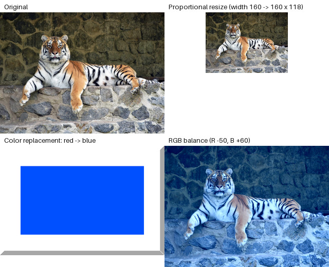

# Lab 01 — Basic Image Operations

A [Tkinter app](main.py) for the first set of image operations. Its [processing functions](operations.py) and [tests](tests/test_operations.py) are included; see the [report](../../reports/Звіт_ЛР1_КГВ_Агапов.docx).



The preview applies the functions from [`operations.py`](operations.py) to the tracked [sample inputs](../../assets/input/): the tiger photo is resized and color-balanced, and the flag graphic has its red replaced with blue. It shows processed images, not the GUI.

| Operation | Result |
| --- | --- |
| Format conversion | Saves the image as PNG, JPEG, BMP, TIFF, or WebP; JPEG and BMP drop transparency. |
| Proportional resize | Computes the missing side from the aspect ratio, or uses both sides when both are given. |
| Color replacement | Replaces every pixel of one exact RGB color with another and keeps transparency. |
| RGB balance | Adds a separate offset to each channel and clamps the result to 0–255. |

From the repository root, [install the dependencies](../../README.md#run-and-test), then:

```bash
cd labs/lab01
python main.py
python -m pytest
```
