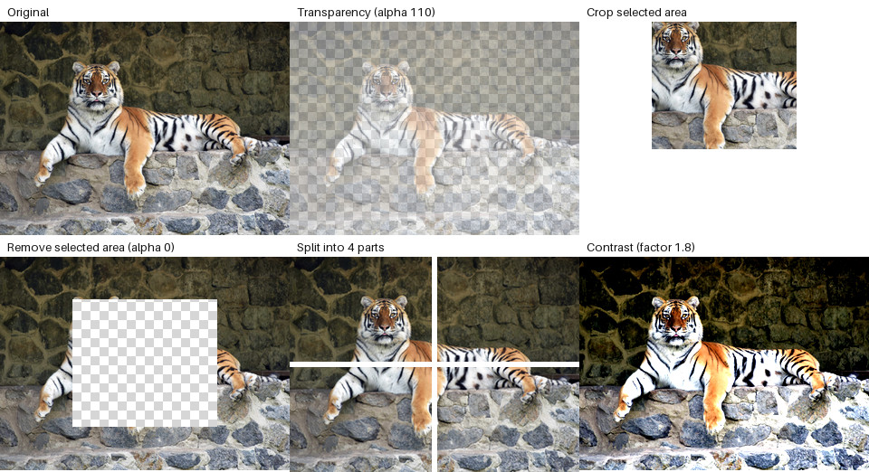

# Lab 02 — Regions and Contrast

This [Tkinter app](main.py) adds region-based image operations to [Lab 01](../lab01/main.py). Its [processing functions](operations.py) and [tests](tests/test_operations.py) are included; see the [report](../../reports/Звіт_ЛР2_КГВ_Агапов.docx).



The preview applies the functions from [`operations.py`](operations.py) to the tracked tiger [sample input](../../assets/input/tigr-1024x754.jpg), resized to 320 pixels wide. Transparent areas are drawn over a checkerboard. The image shows processed results, not the GUI.

| Operation | Result |
| --- | --- |
| Transparency | Applies an alpha value and saves a PNG. |
| Crop or remove an area | Keeps or removes a selected rectangle. |
| Split image | Saves the requested number of image parts. |
| Contrast | Adjusts contrast using the lab formula. |

The app also offers Lab 01's format conversion, proportional resize, color replacement, and RGB balance. Only the preview above is tracked; choose a [sample input](../../assets/input/) and an output folder to create your own results.

From the repository root, [install the dependencies](../../README.md#run-and-test), then:

```bash
cd labs/lab02
python main.py
python -m pytest
```
