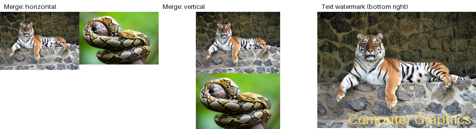

# Lab 03 — Merging, Watermarks, and Slideshows

This [Tkinter app](main.py) extends [Lab 02](../lab02/README.md) with three features. Its [processing functions](operations.py), [tests](tests/test_operations.py), and [report](../../reports/Звіт_ЛР3_КГВ_Агапов.docx) are included.



The preview applies `merge_images` and `add_text_watermark` from [`operations.py`](operations.py) to the tracked tiger and python [sample inputs](../../assets/input/), scaled down for the montage. The slideshow is a GUI feature and is not shown.

| Feature | Result |
| --- | --- |
| Merge images | Places two images side by side or one above the other on a white canvas. |
| Text watermark | Places text using the selected position, color, font size, and opacity. |
| Slideshow | Shows selected images in a Tkinter window with Start/Stop controls. |

The earlier conversion, resizing, color, transparency, region, splitting, and contrast operations remain available. Only the preview above is tracked; the GUI creates your own results from [sample inputs](../../assets/input/) in a folder you select.

From the repository root, [install the dependencies](../../README.md#run-and-test), then:

```bash
cd labs/lab03
python main.py
python -m pytest
```
