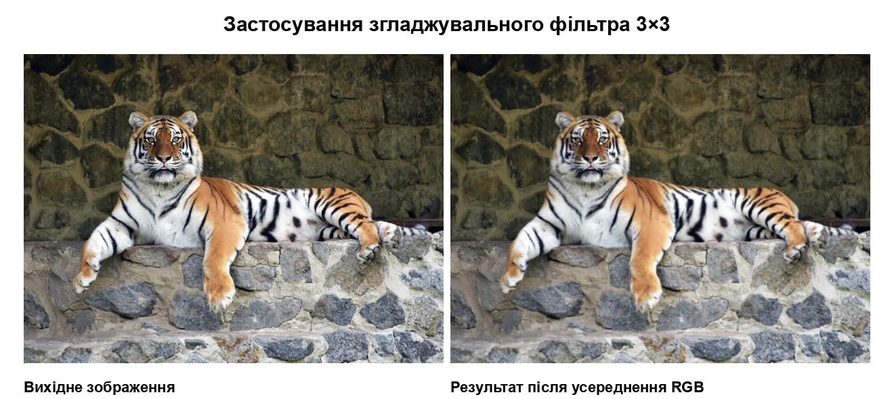
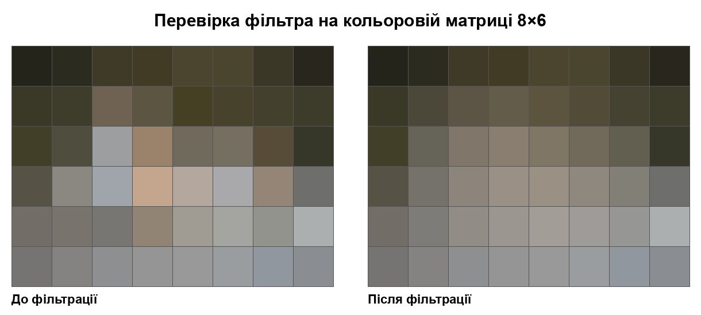

# Lab 05 — Smoothing Filter

Variant 1: a hand-written 3×3 smoothing (mean) filter, applied through the same [Tkinter app](main.py) as the earlier labs. The filter is [`smoothing_filter`](operations.py) and is covered by [tests](tests/test_operations.py).



The figure is one of the [report illustrations](report_assets/) for this lab: the [tiger sample](../../assets/input/tigr-1024x754.jpg) before and after filtering. Its captions are in Ukrainian ("Вихідне зображення" — source image; "Результат після усереднення RGB" — result after RGB averaging).

## Algorithm

- Every interior pixel uses a 3×3 window: the pixel itself and its eight neighbors.
- The R, G, and B channels are averaged separately.
- The rounded averages become the pixel in a new image; all reads come from the original.
- Border pixels are left unchanged.

The result has softer color transitions. To check the effect pixel by pixel, the [8×6 test matrix](../../assets/input/matrix_source_8x6.png) shows each averaged cell:



Captions: "До фільтрації" — before filtering; "Після фільтрації" — after filtering.

## Run

From the repository root, [install the dependencies](../../README.md#run-and-test), then:

```bash
cd labs/lab05
python main.py
python -m pytest
```

## Try it in the GUI

1. Click **Choose images** and pick a picture.
2. Click **Choose output folder**.
3. In the lab list (**Лабораторна робота**) choose **ЛР №5 — Фільтрація**.
4. In the operation list (**Операція**) choose **Згладжувальний фільтр** (smoothing filter).
5. Click **Run processing**.

For `original.jpg` the app saves `original_smoothing.png` and opens the result.
