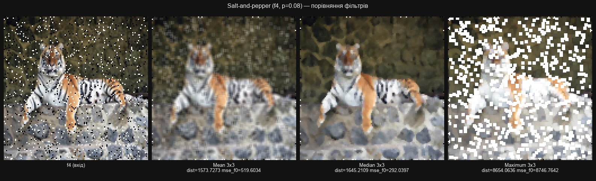
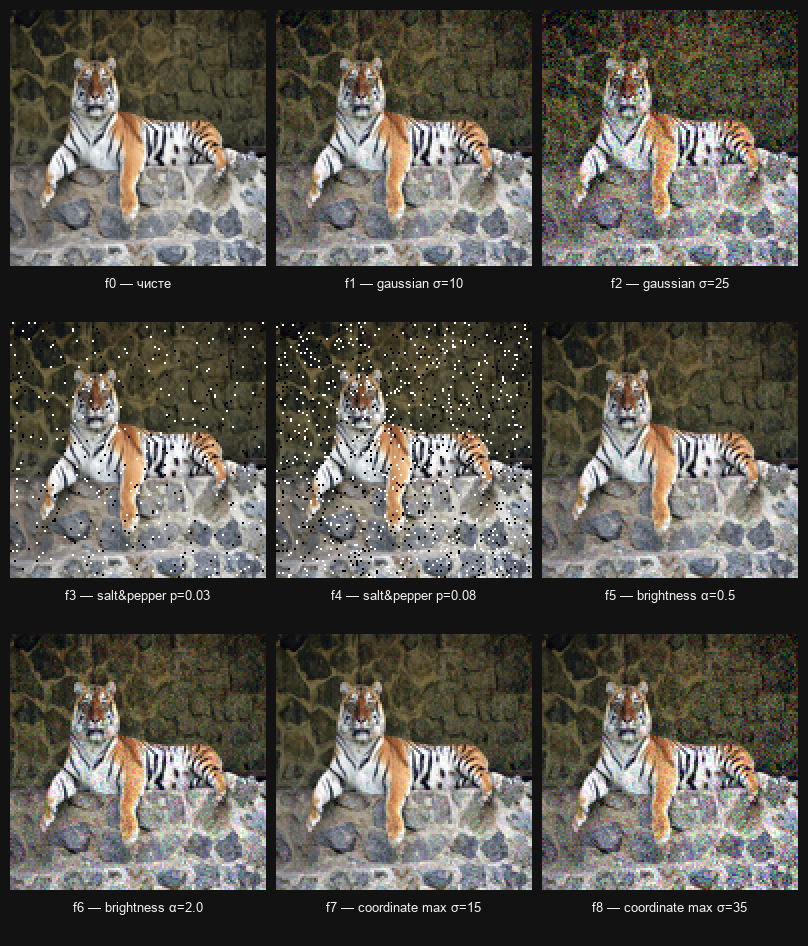
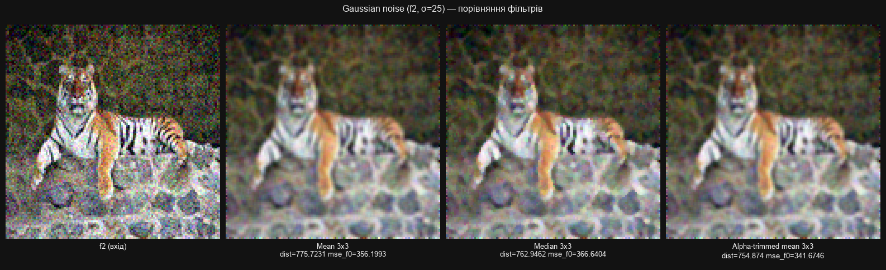
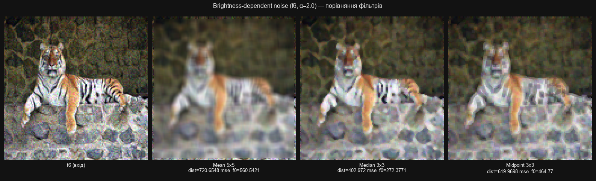
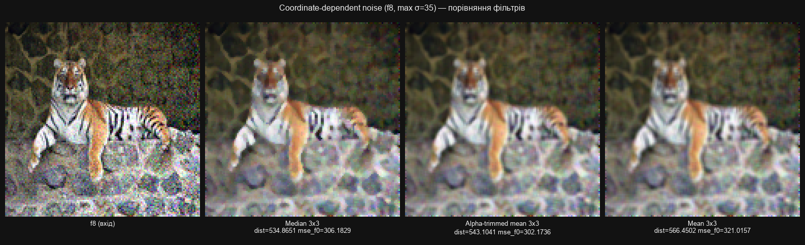

# Lab 06 — Evaluating Image Filtering Quality

**Topic:** assessing linear and nonlinear image filters on test images with different kinds of noise.

**Goal:** generate noisy versions of an image, apply ten filters implemented by hand, and compare them with a numeric quality metric. The code is in [`operations.py`](operations.py) and is covered by [tests](tests/); the [report](report_lab06.docx) is included.



The figure compares three of the ten filters on `f4` (salt-and-pepper noise, p ≈ 0.08). The median filter removes the isolated black and white pixels and ends up closest to the clean image (`mse_f0` ≈ 292, against ≈ 520 for the mean filter and ≈ 8747 for the maximum filter). The values are reproducible: running [`operations.py`](operations.py) on the tracked [tiger input](../../assets/input/tigr-1024x754.jpg) with the fixed seed gives the same numbers. Titles are partly Ukrainian ("порівняння фільтрів" — filter comparison; "вхід" — input).

## How it works

```
clean image (f0)
      ↓
generate 4 noise types at 2 strengths each → f1..f8
      ↓
apply 10 filters (3 linear + 7 nonlinear) to f0..f8
      ↓
compute a quality metric for every result
      ↓
create a browser-ready demonstration page and metrics.csv
```

## Test images

The app prepares nine 128×128 BMP images from the source image you choose: it converts it to RGB, resizes it to 128×128, and saves it as `f0.bmp`. `f1.bmp` … `f8.bmp` are generated from `f0`.



| Image | Noise type | Parameter |
| --- | --- | --- |
| `f0` | none | — |
| `f1` | additive Gaussian (weaker) | σ = 10 |
| `f2` | additive Gaussian (stronger) | σ = 25 |
| `f3` | impulse (salt-and-pepper, weaker) | p ≈ 0.03 |
| `f4` | impulse (salt-and-pepper, stronger) | p ≈ 0.08 |
| `f5` | brightness-dependent (weaker) | variance = 0.5 × brightness |
| `f6` | brightness-dependent (stronger) | variance = 2.0 × brightness |
| `f7` | coordinate-dependent (weaker) | σ(x, y) up to 15 |
| `f8` | coordinate-dependent (stronger) | σ(x, y) up to 35 |

The σ and p values are simple implementation parameters, not an official requirement of the assignment; they make the weaker and stronger variant of each noise type clearly different. All noise uses a fixed `random.seed(42)` (`RANDOM_SEED` in `operations.py`), so repeated runs produce identical `f0`…`f8`.

Additive noise follows `I_noisy(x, y) = I(x, y) + N(x, y)`, and every RGB value is clamped to 0..255 afterwards.

## Filters

| Filter | Type | Window |
| --- | --- | --- |
| Mean 3×3 | linear | 3×3 |
| Mean 5×5 | linear | 5×5 |
| Mean 7×7 | linear | 7×7 |
| Median 3×3 | nonlinear | 3×3 |
| Median 5×5 | nonlinear | 5×5 |
| Median 7×7 | nonlinear | 7×7 |
| Minimum 3×3 | nonlinear | 3×3 |
| Maximum 3×3 | nonlinear | 3×3 |
| Midpoint 3×3 | nonlinear | 3×3 |
| Alpha-trimmed mean 3×3 | nonlinear | 3×3 |

All filters process R, G, and B separately. They read neighbors only from the original copy (`source`) and write into a separate copy (`result`). As the assignment requires, borders are not processed: for an N×N window a pixel is filtered only when the whole window fits around it (margin = N // 2); edge pixels stay unchanged.

Linear filters (`mean_filter`) build a new pixel as a linear combination (the average) of its neighbors. Nonlinear filters either sort the window values (`median_filter`, `alpha_trimmed_mean_filter`) or take `min`/`max` (`minimum_filter`, `maximum_filter`, `midpoint_filter`), which is not a linear combination of pixels.

## Quality metric

```
ε² = 1/(N·M) · ΣΣ |g(i,j) - f(i,j)|²
```

For every pair of corresponding pixels the difference is squared, then averaged over all pixels and channels (R, G, B separately). The implementation is `calculate_mse(image_a, image_b)` in `operations.py`; a smaller value means the images are closer.

`demonstration.html` is the main file for presenting the result: it shows four representative noise cases, the best filter for each case, and a full metrics table that can be opened in any browser. `metrics.csv` remains the complete machine-readable export.

`metrics.csv` has two metric columns for every image-and-filter pair:

- `distortion_vs_input` is the **metric required by the assignment**: the difference between the filtered result and the image that was filtered (`f0` for the clean image, `fk` for a noisy one). It shows how much the filter changed its input.
- `mse_vs_clean` is an **additional metric**: the difference between the filtered noisy `fk` and the clean `f0`. It shows how close the filter brought the noisy image back to the original. It complements the main metric rather than replacing it; the report explains the difference and an example where they diverge.

## More comparisons

Each figure shows the noisy input and three of the ten filters, with both metrics under every result.

| Noise | Figure |
| --- | --- |
| Gaussian, σ = 25 (`f2`): alpha-trimmed mean has the lowest `mse_f0` of the three shown (≈ 342). |  |
| Brightness-dependent, α = 2.0 (`f6`): median 3×3 has the lowest `mse_f0` of the three shown (≈ 272). |  |
| Coordinate-dependent, max σ = 35 (`f8`): alpha-trimmed mean has the lowest `mse_f0` of the three shown (≈ 302). |  |

## Run

From the repository root, [install the dependencies](../../README.md#run-and-test), then:

```bash
cd labs/lab06
python main.py
python -m pytest
```

## Full analysis in the GUI

1. Click **Choose images** and pick one source image (the first one in the list becomes `f0`).
2. Click **Choose output folder** and pick a folder for the results.
3. In the lab list (**Лабораторна робота**) choose **ЛР №6 — Оцінка якості фільтрації** (the default).
4. Leave the operation as **Аналіз фільтрації ЛР6** (Lab 6 filtering analysis).
5. Click **Run processing**.

The app then:

1. creates `f0.bmp` … `f8.bmp` in `<output>/lab06_results/test_images/`;
2. applies all 10 filters to each of the 9 images (90 results), saved in `<output>/lab06_results/all_results/`;
3. computes the metrics and saves `<output>/lab06_results/metrics.csv`;
4. creates `<output>/lab06_results/demonstration.html` and opens it in the browser.

The generated result folder stays compact:

```text
lab06_results/
├── demonstration.html  # presentation page with examples and a readable metrics table
├── metrics.csv         # full machine-readable export
├── test_images/        # f0...f8
└── all_results/        # all 90 filtered images
```

## Main functions

- `prepare_base_image`, `add_gaussian_noise`, `add_salt_pepper_noise`, `add_brightness_dependent_noise`, `add_coordinate_dependent_noise`, `generate_test_images` — prepare `f0` and generate `f1`…`f8`.
- `mean_filter`, `median_filter`, `minimum_filter`, `maximum_filter`, `midpoint_filter`, `alpha_trimmed_mean_filter` — the filters.
- `calculate_mse` — the quality metric.
- `run_filter_analysis` — runs the full analysis (all 9 × 10 combinations and `metrics.csv`).

All of them live in [`operations.py`](operations.py).
